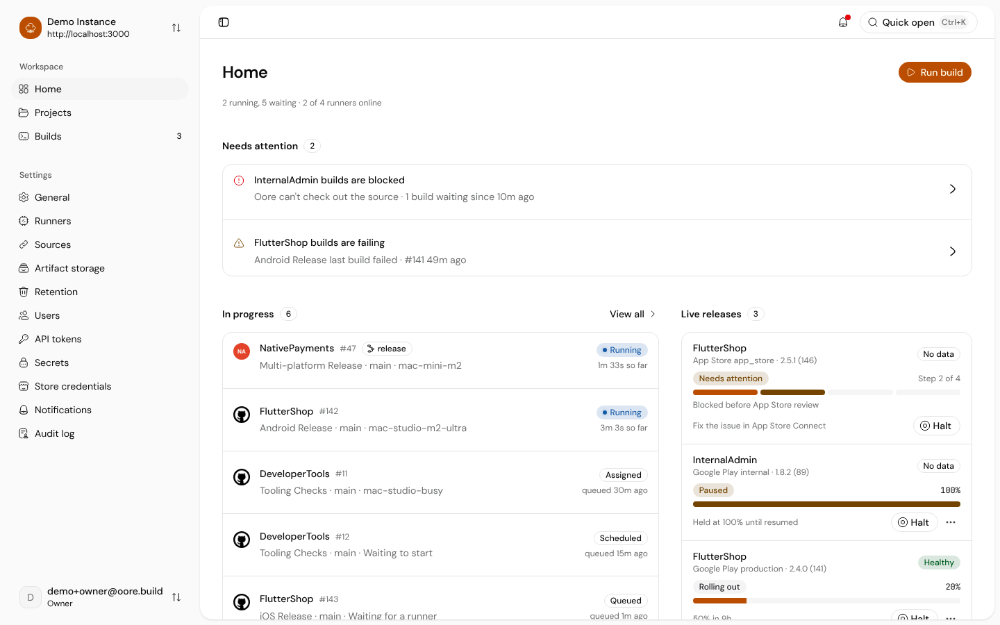
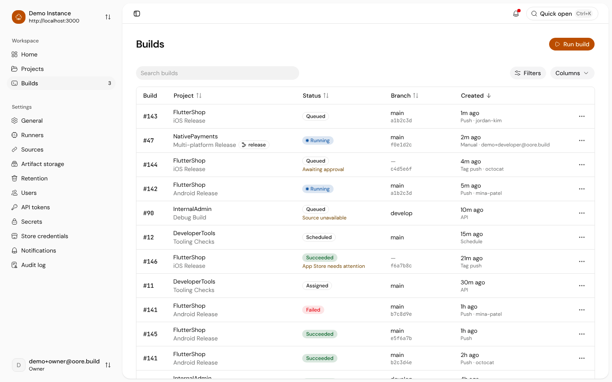
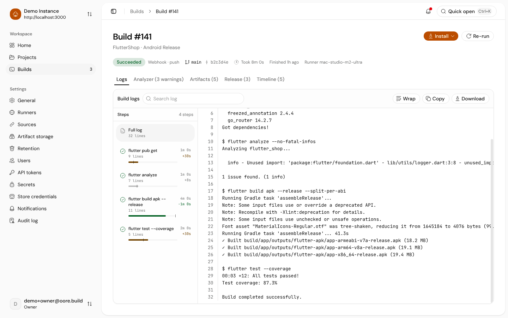
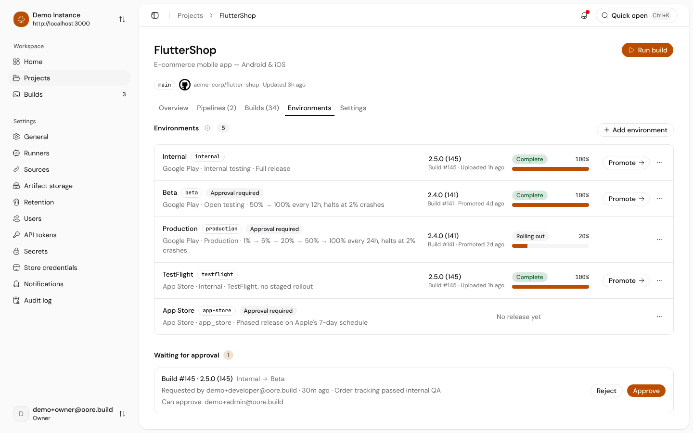

<p align="center">
  
</p>

<h1 align="center">Oore CI</h1>

<p align="center">Self-hosted, Flutter-first mobile CI and internal app distribution platform.</p>

<p align="center">
  <a href="https://docs.oore.build">Documentation</a>
  ·
  <a href="https://demo.oore.build">Live Demo</a>
  ·
  <a href="https://ci.oore.build">Hosted UI</a>
</p>

<p align="center">
  <a href="https://zerodha.tech"></a>
  <br />
  <a href="https://github.com/oore-ci/oore.build/actions/workflows/validate.yml"></a>
</p>

> **Alpha** — APIs, configuration formats, and CLI flags can change before the stable release.

## Overview

Oore CI builds Flutter apps on Macs you control and ships them to testers, Google Play, and the App Store. Builds, signing keys, and artifacts stay on your own hardware. It runs Android, iOS, and macOS builds on a macOS host.

Oore has three parts:

- A daemon (`oored`) that serves the API and schedules builds.
- A runner (`oore-runner`) that runs builds directly on the Mac or in a fresh macOS VM.
- An operator CLI (`oore`) for install, setup, upgrades, and runner management, and a web UI for everything else.

## What you can do

- **Start the day from Home.** See what needs attention, what is running, and what finished, next to live releases and their rollout. Build, project, and store health sit below, with problems sorted first. [Tour the demo](https://demo.oore.build).
- **Keep pipelines in the repository.** A `.oore.yaml` file names one or more workflows. Oore finds the files in the repository, shows what will run, and lets you pick the workflow when you start a build. Pushes and pull requests fan out to every workflow they trigger. [Files, pipelines, and workflows](https://docs.oore.build/concepts/files-pipelines-workflows).
- **Sign once per project.** Store Android keystores and iOS certificates in the project's signing library, and let each workflow sign by name. The runner injects the keystore into Gradle, so apps need no committed keys. [Use the project signing library](https://docs.oore.build/build/sign/project-library).
- **Follow a build in plain words.** The build page shows each step with a readable name and timing, the full log with search, analyzer warnings, artifacts, store releases, and a timeline. Pull request checks report app size against the base branch and can fail on a size budget. [See builds on pull requests](https://docs.oore.build/build/run/pull-request-checks).
- **Ship through environments.** Promote a build from internal testing to beta and production, with approvers per environment. Set staged rollouts to an exact percentage, and see store refusals and Apple's review status on the release. [Promote builds between environments](https://docs.oore.build/build/distribute/environments).
- **Hand builds to testers.** QA Viewers sign in on their phone, install the latest build from any iPhone browser or on Android, and send feedback that lands on the build. A share link sends one file without an account. [Share builds with testers](https://docs.oore.build/build/distribute/testers).
- **Scale out on your own Macs.** Run several builds at once on one Mac, add runners on other Macs, and isolate builds in VMs that start from a warm image per project. [Run builds in VMs](https://docs.oore.build/operate/runners/vm-isolation).
- **Let the team in.** Turn on External Access with OIDC, invite people, and give many of them project roles at once. [Let the team sign in](https://docs.oore.build/team/access).

## Screenshots

| Home                                                                                                                                                                                                                                                      | Builds                                                                                                                                                                                                                                                   |
| --------------------------------------------------------------------------------------------------------------------------------------------------------------------------------------------------------------------------------------------------------- | -------------------------------------------------------------------------------------------------------------------------------------------------------------------------------------------------------------------------------------------------------- |
| <picture><source media="(prefers-color-scheme: dark)" srcset="shared/media/product/demo-dashboard-dark.png" /></picture> | <picture><source media="(prefers-color-scheme: dark)" srcset="shared/media/product/demo-builds-dark.png" /></picture>                          |
| **Build**                                                                                                                                                                                                                                                 | **Environments**                                                                                                                                                                                                                                         |
| <picture><source media="(prefers-color-scheme: dark)" srcset="shared/media/product/demo-build-detail-dark.png" /></picture>           | <picture><source media="(prefers-color-scheme: dark)" srcset="shared/media/product/demo-environments-dark.png" /></picture> |

## Prerequisites

- A Mac on `arm64` (Apple silicon) or `x86_64` (Intel) with administrator access
- `curl`, `tar`, `ssh-keygen`, and the macOS system `/usr/bin/stat`, `/usr/bin/lockf`, and `/usr/bin/shasum`
- Flutter and the platform tools your app builds with. See [Check that your Mac is ready](https://docs.oore.build/start/prerequisites).

For source development, also install [Rust](https://rustup.rs/) and [Bun](https://bun.sh/).

`oore install` manages macOS hosts only. A Web node can also run on Linux from the published web archive; see [Run a Web node on Linux](https://docs.oore.build/operate/deploy/linux-web-node).

## Quick Start

```bash
# Install the latest stable Oore CLI
curl -fsSL https://oore.build/install | bash

# Choose this device role and continue to setup
~/.oore/bin/oore install
```

The download script verifies a signed release manifest and installs only the `oore` CLI. The guided command then offers five device roles:

| Role          | Purpose                                                          |
| ------------- | ---------------------------------------------------------------- |
| Complete      | Run the control plane, local web UI, and builds on this Mac.     |
| Control plane | Manage pipelines and runners without a local web UI or runner.   |
| Runner        | Run builds for a control plane on another Mac.                   |
| Web node      | Serve the web UI for a control plane on another Mac.             |
| CLI only      | Connect the CLI to a ready control plane without local services. |

Interactive installation continues to `oore setup`. SSH sessions use terminal setup. Local Complete installations use browser setup by default.

Then follow the docs for your first app:

- [Install Oore on one Mac](https://docs.oore.build/start)
- [Ship an Android app to testers](https://docs.oore.build/start/android/first-build)
- [Ship an iOS app to TestFlight](https://docs.oore.build/start/ios/first-build)
- [Decide which setup you need](https://docs.oore.build/concepts/which-setup)
- [Known limitations](https://docs.oore.build/reference/known-limitations)
- [Report an issue](https://docs.oore.build/operate/support/report-an-issue)

Install prerelease channels:

```bash
# Bootstrap the CLI from the latest alpha
curl -fsSL https://oore.build/install | OORE_CHANNEL=alpha bash
~/.oore/bin/oore install

# Bootstrap the CLI from the latest beta
curl -fsSL https://oore.build/install | OORE_CHANNEL=beta bash
~/.oore/bin/oore install
```

Check for an update:

```bash
oore update --check
```

`oore update` updates Ready Complete and Control plane installations in place. It drains active runner work, creates a backup, restarts managed services, and restores the prior release if verification fails. Use `oore-web update` on a separate Web node. See [Upgrade Oore](https://docs.oore.build/operate/maintain/upgrade) for the full procedure.

## Development (from source)

```bash
bun install

make clean-dev-state
make run-daemon
make setup-token
make dev-web
```

To explore the UI with seeded data and no daemon, run `bun run dev:demo` in `apps/web` and sign in with any demo account (password `owner`). This is the same demo as [demo.oore.build](https://demo.oore.build).

Notes:

- `make dev-fresh-setup` resets development state, builds the project, and starts the daemon.
- It also starts a Cloudflare quick tunnel and prints the public URL.
- Disable the tunnel with `OORE_DEV_ENABLE_TUNNEL=0 make dev-fresh-setup`.
- The default setup mode uses a token for the hosted UI.
- Use `OORE_DEV_SETUP_MODE=cli make dev-fresh-setup` for CLI-based OIDC setup.
- Development commands store state in `~/.oore/dev.noindex`.

## Project Structure

```
apps/web/                React 19 + TanStack Router (product UI)
apps/docs/               Astro 7 + Fumadocs static documentation
apps/site/               Landing and install site (oore.build)
crates/oored/            Daemon — Axum HTTP server
crates/oore/             Operator CLI — Clap
crates/oore-runner/      Build runner agent
crates/oore-contract/    Shared data types (Serde structs)
crates/oore-google-play/ Google Play Developer API client
crates/oore-cli-ui/      Shared terminal presentation for the CLIs
shared/media/            Product screenshots used by the README, site, and docs
```

## Releases

Releases are published via GitHub Actions.

- A merge to `alpha` creates a `vX.Y.Z-alpha.N` prerelease.
- A merge to `beta` creates a `vX.Y.Z-beta.N` prerelease.
- A merge to `stable` creates a `vX.Y.Z` release.
- A tag builds macOS artifacts, deploys the public sites, and publishes a GitHub release.

The release workflow requires two protected secrets:

- `OORE_RELEASE_SIGNING_KEY` contains the Ed25519 private key.
- `OORE_RELEASE_PUBLICATION_TOKEN` has `Administration: read`, `Contents: write`, and `Workflows: write` for this repository only.

The Ed25519 public key must match [`tools/release-signing-key.pub`](tools/release-signing-key.pub).

Advance `workspace.package.version` in `Cargo.toml` before each release. The autotag workflow never increments patch versions.

## Contributing

- Read [CONTRIBUTING.md](CONTRIBUTING.md) before you submit a pull request.
- Read [CODE_OF_CONDUCT.md](CODE_OF_CONDUCT.md) for community rules.
- Use [SUPPORT.md](SUPPORT.md) for support and issue reporting.

## License

[MIT](LICENSE)
